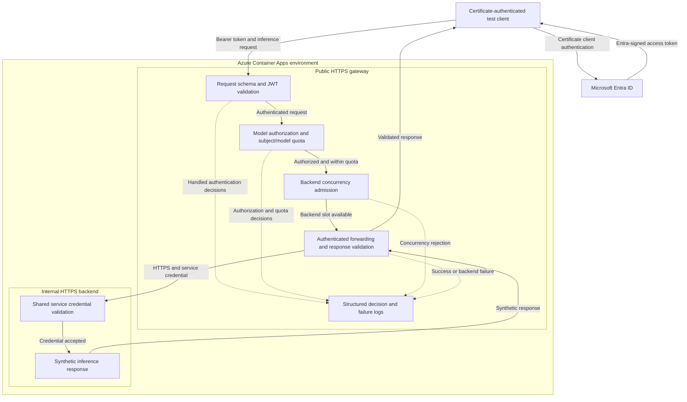

# Security Architecture & Request Flow

## Purpose

This diagram shows the deployed inference request path and the controls enforced between the external client, public gateway, and internal synthetic backend.

Microsoft Entra authenticates the client and signs its access token. The gateway validates that token and applies model authorization, quotas, and concurrency admission before contacting the backend.

## Reading the Diagram

Solid arrows show authentication, request, and response traffic. Dashed arrows show application logging.

The nested boxes distinguish the public gateway from the backend within the same Container Apps environment. They represent application and ingress boundaries, not separate dedicated networks.

### Client and Microsoft Entra ID

The client authenticates to Entra using a registered certificate and an encrypted private key stored outside the repository.

Entra issues the bearer access token. The client certificate does not directly sign the token accepted by the gateway.

The gateway retrieves Entra signing keys through its configured JWKS endpoint. That verification dependency is omitted from the diagram to keep the request path readable.

### Public Gateway

FastAPI validates request syntax and schema before the inference handler runs. Invalid request bodies receive a generic HTTP 422 response.

For valid bodies, the gateway validates the bearer token and checks model authorization before applying admission controls.

The model policy requires:

| Model | Required role |
|---|---|
| research-model | Inference.Reader |
| restricted-model | Inference.Admin |

Roles are not implicitly hierarchical.

The quota is keyed by authenticated subject and requested model. Concurrency admission permits two backend calls per gateway process.

Quota admission occurs before concurrency admission. Consequently, concurrency rejections and backend failures consume quota admissions.

### Internal Backend

The backend has external ingress disabled and insecure HTTP ingress disabled.

The gateway supplies a dedicated shared service credential. The backend compares it with its configured credential and rejects missing or incorrect credentials.

Successful inference returns synthetic data. No actual AI model is invoked.

The gateway validates the response contract before returning the result to the client.

### Logging

Structured events record handled inference outcomes and sanitized backend failures.

The events omit prompts, bearer tokens, service credentials, and caller identity. Request-schema rejection events are not currently included in this decision logging path.

The diagram does not imply durable, tamper-evident audit storage or centralized alerting.

## Failure Behavior

| Condition | Gateway behavior |
|---|---|
| Invalid request schema | HTTP 422 with generic error |
| Missing or invalid bearer token | HTTP 401 |
| Unauthorized or unknown model | HTTP 403 |
| Subject/model quota exhausted | HTTP 429 with Retry-After |
| Concurrency admission rejected | HTTP 503 with Retry-After |
| Missing or invalid backend configuration | HTTP 503 |
| Backend communication, credential rejection, or response failure | HTTP 502 |

Authentication and model-authorization denials do not invoke the backend.

Direct backend credential rejection returns HTTP 401. When encountered through gateway forwarding, that backend rejection is mapped to HTTP 502.

## Boundaries and Limitations

- Internal ingress restricts backend reachability to the Container Apps environment; it is not gateway-exclusive isolation.
- A caller with backend reachability and the shared credential can bypass gateway authorization, quotas, and decision logging.
- Shared credentials do not attest workload identity or provide mTLS.
- Quotas and concurrency limits are process-local and reset on restart.
- Network-phase timeouts are not a strict end-to-end request deadline.
- Registry image-pull managed identity is separate from backend service authentication.
- Health endpoints are omitted from the diagram and do not require inference credentials.
- The separate local governance exercise is not connected to deployed policy changes.
- Remaining container OS vulnerabilities are documented in the container security review.

## Supporting Documents

- [System architecture](system-architecture.md)
- [Threat register](../threat-model/threat-register.md)
- [Validation report](../validation/validation-report.md)
- [Container security review](../validation/container-security-review.md)
